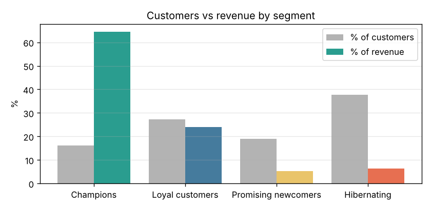
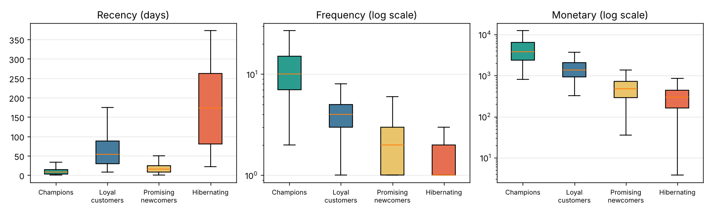
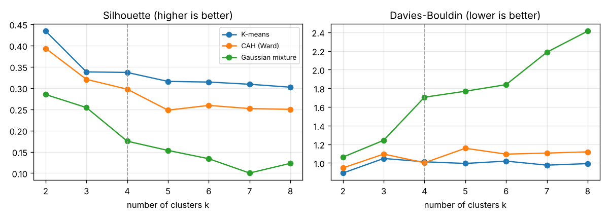
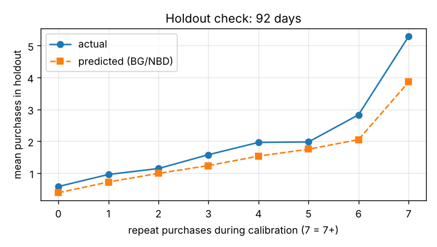

# Customer Segmentation & Lifetime Value

[](https://youri-customer-segmentation.streamlit.app/)

RFM segmentation of **541,909 transactions** (UCI Online Retail, 4,338 customers). The project compares **K-means, hierarchical clustering (CAH, Ward) and a Gaussian mixture**, turns the clusters into **4 actionable segments**, and predicts each customer's **6-month value** with **BG/NBD + Gamma-Gamma** models implemented from the original papers. The results are served in a **[live Streamlit dashboard](https://youri-customer-segmentation.streamlit.app/)**.

> **Key results.** K-means with k = 4 is retained: silhouette 0.34, bootstrap stability ARI 0.94, against 0.30 and 0.41 for CAH. The **Champions are 16 % of customers but 64 % of revenue**. Predicted value for the next 6 months is £4.57M, of which £2.52M comes from the Champions.



## Segments and actions

| Segment | Customers | Median recency | Median orders | Median spend | Share of revenue | 6-month value | Action |
| --- | --- | --- | --- | --- | --- | --- | --- |
| **Champions** | 699 (16 %) | 8 days | 10 | £3,750 | **64 %** | £2.52M | VIP program: early access, referral rewards, no discounts needed |
| **Loyal customers** | 1,178 (27 %) | 54 days | 4 | £1,352 | 24 % | £0.98M | Cross-sell and upsell; loyalty points to move them up to Champions |
| **Promising newcomers** | 826 (19 %) | 16 days | 2 | £480 | 5 % | £0.57M | Onboarding sequence and a second-purchase incentive |
| **Hibernating** | 1,635 (38 %) | 173 days | 1 | £297 | 6 % | £0.50M | Low-cost win-back campaign; remove from expensive channels if no response |



## Method

**1. Cleaning (541,909 → 392,692 rows).** The following rows are removed:
- rows without a customer ID (135,080);
- cancellations, i.e. invoices starting with `C` (8,905);
- rows with a non-positive quantity or price (40);
- exact duplicates (5,192).

**2. RFM features.** For each customer, measured at 10 Dec 2011:
- Recency: days since the last purchase;
- Frequency: number of invoices;
- Monetary: total revenue.

All three are heavily right-skewed, so they are log-transformed, then standardized.

**3. Choosing the method.** Each method is run for k = 2 to 8. For k = 4:

| Method | Silhouette ↑ | Davies-Bouldin ↓ | Calinski-Harabasz ↑ | Stability (ARI) ↑ |
| --- | --- | --- | --- | --- |
| **K-means** | **0.337** | 1.013 | **3,300** | 0.935 |
| CAH (Ward) | 0.297 | **1.002** | 2,739 | 0.411 |
| Gaussian mixture | 0.175 | 1.705 | 2,162 | **0.957** |

Stability is the mean adjusted Rand index between the full partition and partitions refitted on 20 random 80 % subsamples.

k = 2 has the best silhouette (0.43), but it only splits "good" from "bad" customers. k = 4 has almost the same silhouette as k = 3 (0.337 vs 0.338) and gives segments that each lead to a different marketing action.



**4. Naming the segments.** The clusters are ranked by median frequency and spend. The best one becomes Champions and the worst Hibernating. Of the two middle clusters, the more recent one becomes Promising newcomers and the other Loyal customers.

**5. Customer lifetime value.**
- **BG/NBD** predicts the number of future purchases and **Gamma-Gamma** the spend per purchase.
- Both are implemented in `src/segmentation/clv.py` from Fader, Hardie & Lee (2005) and Fader & Hardie (2013), with scipy and no third-party CLV library.
- The unit tests check that the code **reproduces the published parameters** on the CDNOW dataset.
- Fitting starts from several points, because the Gamma-Gamma likelihood has a degenerate local optimum.

**6. Validation on a holdout period.** The models are fitted until 9 Sep 2011, then compared with the next 92 days:
- per-customer purchases: correlation of **0.80**, mean absolute error of 0.94;
- the ranking of customers is good;
- the total is **under-predicted by 25 %** (3,387 vs 4,510 purchases), because the holdout covers the Christmas peak and the models assume stationary behaviour.



**Limitation.** On a single year of data, the BG/NBD dropout parameter is close to 0 (a = 0.004, the same value as with the `lifetimes` package). Churn is therefore not identified, so P(alive) is not used to make decisions.

## Run it

```bash
pip install -r requirements.txt
python scripts/download_data.py     # UCI dataset → data/raw/online_retail.csv
python scripts/run_pipeline.py      # results/*.csv and results/figures/*.png
streamlit run app/streamlit_app.py  # dashboard
python -m pytest                    # unit tests
```

The dashboard only reads `results/`, so it runs without the raw data.

## Structure

```text
├── src/segmentation/
│   ├── data.py         # loading and cleaning
│   ├── rfm.py          # RFM features and scaling
│   ├── clustering.py   # K-means / CAH / GMM, validity scores, bootstrap stability
│   ├── segments.py     # segment naming and actions
│   └── clv.py          # BG/NBD and Gamma-Gamma (from the papers)
├── scripts/            # data download and full pipeline
├── app/                # Streamlit dashboard
├── results/            # tables and figures produced by the pipeline
└── tests/              # unit tests (including reproduction of the published CDNOW results)
```

## Context and my role

This started as a **group project** in the Master IA et Objets Connectés at Université Ibn Tofail (2026). **I trained and compared the clustering models.**

I then rebuilt and extended it :
- comparison of three methods with stability analysis;
- actionable segments;
- lifetime value models implemented from the papers;
- holdout validation;
- interactive dashboard.

## Data and license

Data: Chen, D. (2015). *Online Retail*. UCI Machine Learning Repository, https://doi.org/10.24432/C5BW33 (CC BY 4.0). Code: MIT, see [LICENSE](LICENSE).
